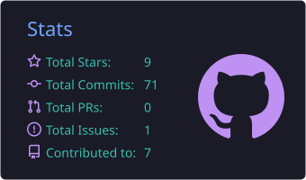
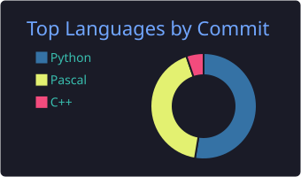

# Olá, eu sou o Assis 👋

**Desenvolvedor back-end, desktop e banco de dados**

---

### 🧭 O que eu faço

- 🏢 **ERP TOTVS WinThor** — rotinas externas, integrações e automações direto no schema Oracle: procedures, funções de preço, filas com Oracle AQ, jobs com `DBMS_SCHEDULER` e o padrão *outbox* para sincronizar dados com plataformas externas.
- 🔌 **APIs e back-end** — serviços em Python (FastAPI/Flask), Node.js/TypeScript e Go que expõem o ERP para apps, força de vendas e parceiros.
- 🖥️ **Desktop** — sistemas e componentes em Lazarus/Free Pascal e Delphi, de ERPs completos a pacotes para a própria IDE.
- 🌐 **Redes e provedores** — MikroTik, VPN hub-and-spoke, VLANs, GPON e a infraestrutura de um ISP na prática.
- 📱 **Mobile e jogos** — apps em Flutter e, nas horas vagas, jogos em C++ e para Android.

### 🚧 Construindo agora

| Projeto | O que é | Destaques |
|---|---|---|
| **Atlas** | SaaS multi-tenant de gestão para provedores de internet: clientes, cobrança, provisionamento PPPoE/GPON, integração MikroTik e suporte. | Módulo de rede óptica · PostgreSQL · Redis · Docker |
| **KryoS** | Sistema completo para oficinas e empresas de refrigeração e climatização: atendimento, orçamentos com aprovação, ordens de serviço, agenda, estoque, compras, financeiro, comissões e garantias. | App offline para o técnico · Gestão de fluidos refrigerantes · PMOC · Backup com RPO de 1 h |
| **Mnemos Vault** | Gerenciador de senhas desktop *local-first*: o cofre fica cifrado no seu computador, sem conta, nuvem, telemetria ou internet. | Argon2id + XChaCha20-Poly1305 · Frase de recuperação de 24 palavras · Backup cifrado |
| [**ExSQL**](https://github.com/assisdantas/ExSQL) | Cliente de banco de dados desktop, minimalista e leve, para conectar e consultar vários SGBDs a partir de uma única interface. | Lazarus/Free Pascal · Múltiplos bancos · Histórico de consultas |

### 📦 Open source

| Projeto | O que é |
|---|---|
| [**argon2laz**](https://github.com/assisdantas/argon2laz) | Bindings Object Pascal para o Argon2 — o vencedor da Password Hashing Competition — com DLLs pré-compiladas para Windows 32/64 bits. Hash de senha seguro no Lazarus sem compilar nada. |
| [**LazUpdateManager**](https://github.com/assisdantas/LazUpdateManager) | Componente não-visual para Lazarus que verifica, baixa e aplica atualizações automáticas em apps desktop. |
| [**FormExpert**](https://github.com/assisdantas/FormExpert) | Pacote para a IDE Lazarus que gera formulários a partir dos campos de um `TSQLQuery`, com wizard de mapeamento, layout e validação. |
| [**vsclaz_theme**](https://github.com/assisdantas/vsclaz_theme) | Esquema de cores para o editor do Lazarus. |

<b>🛠️ Ver stack completa</b>

 

**Linguagens**

  
  
  
  
  
  
  
  

**Frameworks e bancos**

  
  
  
  
  
  
  
  

**Infra e redes**

  
  
  
  
  
  

### 📊 Estatísticas

  
  

  

  <picture>
    <source media="(prefers-color-scheme: dark)" srcset="https://raw.githubusercontent.com/assisdantas/assisdantas/output/github-snake-dark.svg" />
    
  </picture>

---

> *“Always code as if the guy who ends up maintaining your code is a violent psychopath who knows where you live.”* — Martin Golding

💬 Pode me perguntar qualquer coisa — se eu não souber, a gente aprende junto. ⚡

